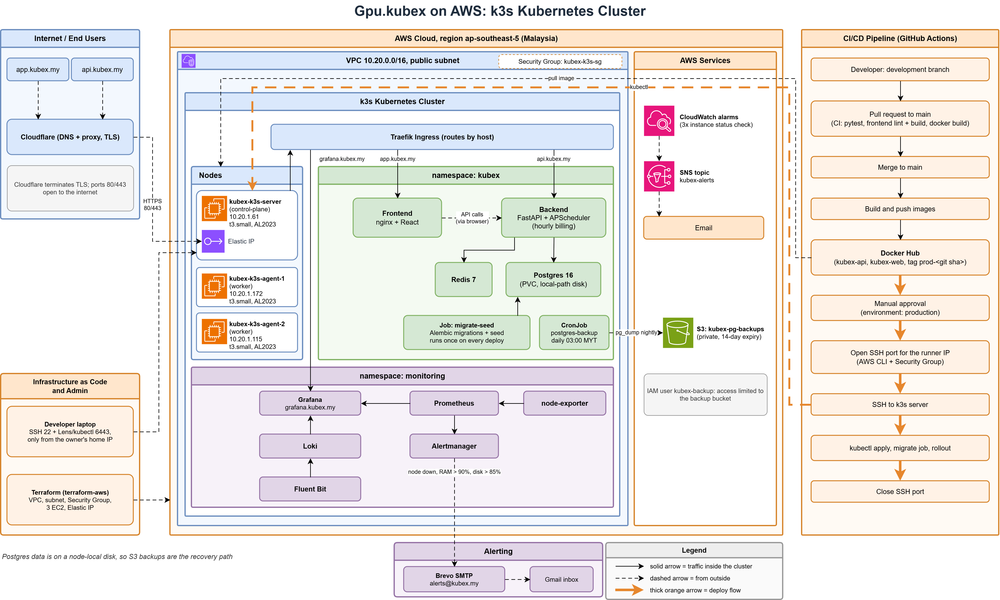

# Gpu.kubex on AWS: k3s Kubernetes Platform

Gpu.kubex is a GPU cloud dashboard, similar to TensorDock or Vast.ai. Users sign up, add funds, deploy simulated GPU/CPU servers and get billed by the hour. There is no real GPU hardware behind it: the focus of this project is the **platform around the app**.

This folder documents the AWS deployment: a self-built 3-node Kubernetes (k3s) cluster on EC2, created with Terraform, deployed with GitHub Actions, with monitoring, alerting and automated backups.

> **Live:** https://app.kubex.my (API docs: https://api.kubex.my/docs)
> The cluster is switched off between work sessions to save cost, so the site may be offline.
>
> The earlier on-prem version (bare metal, Harvester, RKE2) is described in the [main README](../README.md).



## What I built

| Area | What it is |
|---|---|
| App | FastAPI + SQLAlchemy + Alembic (backend), React + Vite + Tailwind (frontend), Postgres 16, Redis 7 |
| Cloud | AWS `ap-southeast-5` (Malaysia): VPC, 1 control-plane + 2 worker EC2 nodes (`t3.small`), Elastic IP |
| Infrastructure as code | Terraform creates the network, security group, servers and IP. k3s is installed through cloud-init |
| Kubernetes | k3s, Traefik ingress, manifests in [`k8s-aws/`](../k8s-aws/) |
| CI/CD | GitHub Actions: tests on every PR, build and push images, manual approval, deploy from a self-hosted runner inside the cluster network (no SSH) |
| Edge | Cloudflare in front: DNS, proxy and TLS |
| Monitoring | Prometheus, Grafana, Loki, Fluent Bit, node-exporter |
| Alerting | Alertmanager sends email (Brevo SMTP) for node down, RAM above 90% and disk above 85%. CloudWatch alarms and SNS cover EC2 status checks |
| Backups | Nightly `pg_dump` CronJob to a private S3 bucket (14-day expiry). A restore was tested |

## How it works

**A request:** browser → Cloudflare (TLS) → Elastic IP → Traefik ingress → the frontend or backend service → Postgres and Redis. Grafana is served through the same ingress.

**A deploy:**
1. Work happens on `development`. A pull request to `main` runs the backend tests (pytest), the frontend lint and build, and a Docker build.
2. Merging to `main` builds the backend and frontend images and pushes them to Docker Hub, tagged with the git SHA.
3. The `production` environment waits for a manual approval.
4. The deploy job runs on a self-hosted GitHub runner on a worker node. It talks to the cluster with a limited `deployer` account (only the `kubex` namespace, no access to Secrets), runs the database migration job, and rolls out the backend and frontend. No SSH, no open port 22 and no AWS keys are used.

**Billing:** an hourly job charges every running server for compute plus storage. It is safe to run twice: a unique `(instance_id, hour)` key and `ON CONFLICT DO NOTHING` make sure an hour is never charged twice. 18 tests run against a real Postgres to prove it.

**Backups:** a CronJob runs every night at 03:00 (Malaysia time), dumps the database and uploads it to S3. The bucket deletes files after 14 days.

## Rules the app follows

- Money is stored as whole cents everywhere and only formatted as dollars in the browser.
- Prices are never trusted from the client. The server looks up the plan and copies its rates onto the instance at deploy time.
- Servers are soft-deleted (`status = terminated`), never removed from the database.
- Dashboard totals are calculated in SQL on the server, not added up in the browser.
- Every query is scoped to the logged-in user.

## Decisions and lessons

- **GitOps with Argo CD, then back to a simple deploy.** I ran Argo CD with a bot that opened a pull request for every image tag. On 2 GB nodes it used a lot of memory, and each release needed two PRs. I removed it and went back to a simple push-based pipeline with an approval step (first over SSH, now from a self-hosted runner). The Argo CD files are still in [`k8s-aws/argocd/`](../k8s-aws/argocd/).
- **Managed database, then back to Postgres in the cluster.** I tried Supabase's free plan. It has no automatic backups and pauses after a week of no use, so I moved the data back and kept my own backup job.
- **No SSH in the pipeline.** Port 22 and the Kubernetes API port (6443) are open only to my own IP. The deploy used to open port 22 for GitHub's runner and close it afterwards. Now a self-hosted runner on a worker node connects out to GitHub, so nothing is opened, and its kubeconfig never leaves the node. The `production` environment only accepts deploys from `main`.
- **Cloud-init timing.** The first install of k3s sometimes failed because the network was not ready at boot. I learned to check each node on its own and to never leave the join token empty.

## Known limits

- Postgres runs as a single pod on a node-local disk. If that node is lost, the nightly S3 backup is the recovery path.
- The nodes are small (2 GB). Adding more monitoring means checking memory first.
- TLS is handled by Cloudflare. There is no certificate management inside the cluster.

## Where to find things

| What | Where |
|---|---|
| Terraform for AWS | [`terraform-aws/`](../terraform-aws/) |
| Kubernetes manifests, monitoring, backup job | [`k8s-aws/`](../k8s-aws/) |
| CI and deploy pipelines | [`.github/workflows/`](../.github/workflows/) |
| Backend (FastAPI) | [`backend/`](../backend/) |
| Frontend (React) | [`frontend/`](../frontend/) |
| Page mockups | [`design/`](../design/) |

## Run it locally

```
docker compose up -d --build
```

Frontend: http://localhost:5173 · Backend: http://localhost:8000 (docs at `/docs`). New accounts start with a $0 balance. Add funds under Billing before you deploy a server.
